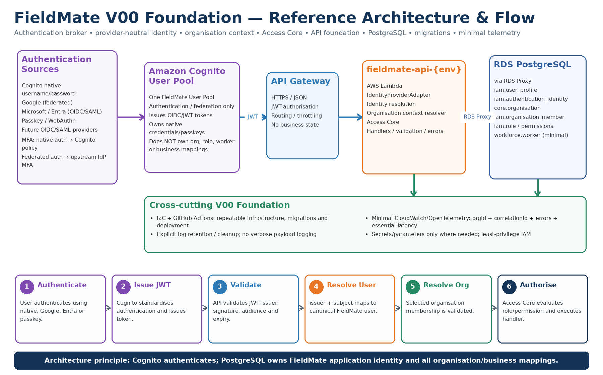

# CR-FM-V00 — FieldMate V00 Foundation

**Status:** Ready for Claude planning / implementation input  
**Vertical:** V00 Foundation  
**Workflow coverage:** Cross-cutting foundation  
**Primary purpose:** Establish the minimum production-grade platform foundation required by all later FieldMate vertical slices.

---

## 1. Authoritative references

Before planning or implementation, Claude **must** review the following project artifacts and reconcile this CR against them:

1. `Docs/FieldMate_Master_Screen_Architecture_XRay_FINAL.xlsx`
2. `Docs/FieldMate_Stage1_Prototype_Implementation_Plan.docx`
3. The current completed generic FieldMate prototype in the repository.
4. This V00 CR and the embedded reference diagrams below.

This CR is intentionally narrower than the full platform. It establishes the common runtime, identity, organisation context, authorisation, persistence, migrations, deployment, and minimal traceability needed before VS01.

### Reference architecture



### Supplementary identity/authentication reference


> The diagrams are reference visuals. Where a visual conflicts with this CR or with a subsequently approved architectural decision, the written CR and approved ADRs take precedence.

---

## 2. V00 summary

| Item | Decision |
|---|---|
| Vertical | V00 Foundation |
| Workflow coverage | Cross-cutting |
| Main components | API host, identity provider abstraction, organisation context, Access Core, DB layer, migrations, minimal telemetry, IaC/CI-CD |
| Core tech/services | API Gateway, AWS Lambda, Amazon Cognito User Pools, Amazon RDS for PostgreSQL, optional/production RDS Proxy, CloudWatch/OpenTelemetry, IaC, GitHub Actions |
| External integrations | None required for V00 business functionality. Google/Microsoft may be configured only as authentication providers through Cognito. |
| Primary structured store | Standard Amazon RDS for PostgreSQL — **not Aurora** |
| Initial NoSQL decision | **Do not use DynamoDB initially** |
| Tenant boundary | `organisation_id` |
| Application identity source of truth | PostgreSQL |
| Authentication authority | Cognito User Pool initially, behind a provider-neutral identity abstraction |
| Application authorisation | Access Core |
| Logging posture | Minimal, structured, organisation-traceable, short retention |
| Cost posture | Zero-cost-first; no idle-cost resources without explicit justification |

---

## 3. Goals

V00 must provide a small, secure, portable, low-cost foundation that every later vertical can reuse.

The goals are to:

- provide a stable API entry point for web/mobile clients;
- authenticate users using one Cognito User Pool with multiple authentication methods;
- keep FieldMate application identity and all business mappings in PostgreSQL;
- make the authentication provider replaceable in the future;
- resolve and validate organisation context for every tenant-scoped operation;
- enforce Access Core before application actions execute;
- establish PostgreSQL, migrations, transaction boundaries, and tenant-safe data access;
- establish minimal, low-cost, organisation-level traceability;
- establish repeatable infrastructure and deployment automation;
- provide an implementation pattern that VS01 and later slices can copy.

---

## 4. Non-goals

V00 must **not** expand into application features.

Out of scope:

- customers;
- leads;
- work requests;
- jobs/projects;
- tasks/workflows;
- scheduling;
- quotes;
- invoices/payments;
- files/evidence;
- reporting;
- AI/Copilot;
- voice;
- subscriptions;
- real custom-domain provisioning;
- external accounting/calendar/CRM integrations;
- advanced analytics;
- OpenSearch;
- Redis/ElastiCache;
- DynamoDB;
- Aurora;
- microservice-per-capability decomposition.

Only the minimum identity, organisation, role/permission and worker scaffolding needed by later verticals is allowed.

---

# 5. Mandatory architectural principles

These principles apply to V00 and must be inherited by every later FieldMate vertical.

## AP-01 — Zero-cost-first

Prefer designs that have **no idle cost** or the lowest practical cost.

Order of preference:

1. deterministic/local/client-side capability where safe;
2. AWS/serverless pay-per-use capability;
3. existing shared managed service;
4. new always-on managed infrastructure only where justified by a measured requirement.

Do not introduce technology merely because it is common in enterprise architectures.

Every CR must state its incremental cost impact.

---

## AP-02 — Stop or remove paid non-production resources when not in use

Development/test resources that create ongoing cost must not be left running unnecessarily.

Examples:

- Lambda/API Gateway naturally incur little/no idle compute cost.
- Development RDS must be stopped when practical during inactive periods.
- Where RDS stop-duration/platform limitations make long inactivity expensive, snapshot and remove/recreate rather than leaving it running indefinitely.
- Do not leave test environments, temporary databases, NAT gateways, RDS Proxy instances, or other hourly-cost resources active without need.
- Automate environment shutdown/cleanup where practical.
- Production availability requirements are handled separately and must be explicitly justified.

**Default rule:** no paid idle resource survives simply because it was created.

---

## AP-03 — High performance through simplicity

Performance should come from:

- simple synchronous request paths;
- efficient PostgreSQL schemas and indexes;
- bounded payloads;
- minimal network hops;
- avoiding unnecessary queues and intermediate services;
- direct S3 upload later for file bytes;
- caching only when measurements prove a need.

Do not add Redis, OpenSearch, Step Functions, Kafka/MSK, or extra microservices speculatively.

---

## AP-04 — Generic platform, not trade-specific architecture

V00 must not contain plumbing-, electrical-, building-, landscaping-, or other industry-specific concepts.

Canonical platform concepts remain generic.

The same foundation must support all FieldMate organisations and future domains.

---

## AP-05 — Provider portability / minimise AWS lock-in

AWS is the initial hosting platform, not the FieldMate domain model.

Application code must avoid unnecessary direct coupling to AWS-specific APIs.

Use narrow adapters for:

- authentication provider;
- secrets/configuration;
- event transport where introduced later;
- object storage where introduced later;
- external providers.

Cognito must be replaceable by Microsoft Entra, Ping Identity, Auth0, Okta, or another standards-compliant IdP without changing FieldMate business data.

Prefer standards such as:

- HTTPS;
- JSON;
- OAuth2;
- OIDC;
- JWT;
- WebAuthn;
- SQL/PostgreSQL.

---

## AP-06 — PostgreSQL is the application system of record

Standard Amazon RDS for PostgreSQL is the primary structured store.

Do **not** use Aurora initially.

Do **not** use DynamoDB initially.

Use relational modelling, PK/FK constraints, indexes, transactions, and selective JSONB only for genuinely flexible configuration.

---

## AP-07 — `organisation_id` is the primary tenant boundary

Every tenant-owned record must carry `organisation_id` unless it is genuinely platform-global.

Tenant access must never depend only on a client-supplied organisation ID.

The backend must validate authenticated user membership before establishing trusted organisation context.

---

## AP-08 — Authentication and application identity are separate

Cognito authenticates.

PostgreSQL owns the canonical FieldMate application user and every application/business relationship.

Cognito must **not** be the source of truth for:

- organisation membership;
- FieldMate role;
- permissions;
- worker ID;
- skills;
- subscription/entitlement;
- business configuration;
- customers/jobs/tasks or other domain data.

---

## AP-09 — Provider-neutral canonical identity

Do not make `cognito_sub` the canonical FieldMate user ID.

Use:

- `iam.user_profile` for the canonical FieldMate user;
- `iam.authentication_identity` for provider mappings.

The portable authentication identity key is conceptually:

`issuer + subject`

Example:

```text
iam.authentication_identity
- id
- user_id
- issuer
- subject
- provider
- identity_type
- email_at_link_time
- created_at
- last_seen_at
```

This supports migration from Cognito to Entra/Ping/Auth0/etc. without changing the canonical FieldMate user or business relationships.

---

## AP-10 — One Cognito User Pool initially

Use one FieldMate Cognito User Pool, not one pool per organisation or authentication method.

Supported/anticipated authentication methods:

- Cognito-native username/password;
- Google federation;
- Microsoft/Entra federation through OIDC/SAML as appropriate;
- WebAuthn/passkeys;
- future standards-based providers.

MFA is a policy/capability of the authentication route, **not another user pool**.

For federated authentication, upstream IdP MFA should normally be respected rather than forcing duplicate MFA in Cognito.

For native Cognito username/password, Cognito may enforce configured MFA.

---

## AP-11 — FieldMate never stores passwords

Do not build a custom FieldMate password database.

Cognito owns native credentials initially.

Google/Microsoft/etc. own their respective upstream credentials.

If Cognito is replaced later:

- federated users are re-linked through the new broker;
- native password users may use JIT migration or password reset;
- canonical FieldMate `user_id` remains unchanged.

---

## AP-12 — Identity provider abstraction

Create a narrow conceptual abstraction around authentication-provider-specific behaviour.

Example responsibilities:

```text
IdentityProviderAdapter
- validateToken(...)
- resolveSubject(...)
- getClaims(...)
- beginPasswordReset(...)
- logout(...)
```

Do not expose Cognito-specific types throughout application/domain code.

Access Core must work with a trusted FieldMate principal, not with Cognito-specific concepts.

---

## AP-13 — Access Core is central

Authentication answers:

> Who authenticated?

Access Core answers:

> May this FieldMate user perform this action in this organisation on this resource?

The normal path is:

```text
JWT
  -> token validation
  -> authentication identity resolution
  -> FieldMate user
  -> organisation membership validation
  -> trusted request context
  -> Access Core
  -> application handler
```

---

## AP-14 — AI never bypasses application services

Although AI is outside V00, the foundation must preserve this rule:

AI/agents may reason and propose actions, but all mutations later go through controlled application services and Access Core.

No direct LLM-to-database mutation path.

---

## AP-15 — Minimal observability

Do not create a “log everything” architecture.

For tenant-scoped requests, the minimum trace context is:

- `organisationId`;
- `correlationId`;
- `userId` / actor where authenticated;
- `resourceId` where relevant;
- operation name;
- error code where failed;
- essential latency;
- cost metadata only where relevant.

Avoid:

- full request/response logging;
- PII payload dumping;
- method entry/exit logs;
- duplicate logs at every layer;
- full AI prompts/responses in operational logs later;
- successful health-check noise.

---

## AP-16 — Organisation-level traceability

Every tenant-scoped request, domain event, audit record, AI usage record and cost record introduced later must be attributable to `organisationId`.

`organisationId` must be propagated as structured metadata, not embedded only in free text.

Platform/pre-auth operations may use:

```text
organisationId = null
scope = PLATFORM
```

---

## AP-17 — Explicit log retention and automatic cleanup

Operational logs are temporary diagnostic data.

Default posture:

- normal operational logs: 7–14 days;
- error logs: around 30 days if needed;
- temporary debug logs: 1–3 days;
- successful health-check logs: avoid where possible;
- business/audit history: separate intentional persistence.

No CloudWatch log group should default to indefinite retention unless explicitly approved.

Use managed retention rather than creating a cleanup Lambda solely to delete CloudWatch logs.

---

## AP-18 — No duplicate telemetry

Do not independently log the same successful state change in API Gateway, handler, application service, repository and database.

Prefer one useful structured business event plus error telemetry.

---

## AP-19 — Infrastructure as Code

All AWS infrastructure required by V00 must be reproducible through approved IaC.

Do not create undocumented console-only infrastructure.

IaC should cover at least:

- Cognito;
- API Gateway;
- Lambda;
- RDS/PostgreSQL;
- networking/security groups if required;
- log groups and retention;
- secrets/parameters;
- IAM;
- optional RDS Proxy where enabled.

---

## AP-20 — Capability-first modular monolith initially

Logical components do not imply separate deployable microservices.

Use one shared synchronous API Lambda initially.

Keep code modular by capability/application service.

Split deployments only when scale, isolation, security, runtime, or ownership genuinely require it.

---

# 6. V00 logical architecture

```text
Authentication Sources
----------------------
Cognito native username/password
Google
Microsoft / Entra
Passkey / WebAuthn
Future OIDC/SAML providers
           |
           v
Amazon Cognito User Pool
(authentication/federation only)
           |
      OIDC / JWT
           |
           v
Amazon API Gateway
           |
           v
fieldmate-api-{env}
AWS Lambda
--------------------------------
Token validation / adapter
Identity resolution
Organisation context resolver
Access Core
Handlers / validation / errors
           |
           v
RDS Proxy (production/preferred when justified)
           |
           v
Amazon RDS PostgreSQL
--------------------------------
iam.user_profile
iam.authentication_identity
core.organisation
iam.organisation_member
iam.role
iam.permission
iam.role_permission
workforce.worker (minimal)
```

Cross-cutting:

```text
IaC + CI/CD
Minimal CloudWatch / OpenTelemetry
Explicit retention
Secrets / parameters
Database migrations
Correlation context
```

---

# 7. Authentication and authorisation flow

## 7.1 Authentication

1. User selects an authentication method.
2. Cognito authenticates directly or federates to the selected external IdP.
3. Cognito issues OIDC/JWT tokens.
4. Client calls FieldMate API with the access token.
5. API validates issuer, signature, audience/client and expiry.
6. Identity adapter extracts `issuer + subject`.
7. FieldMate resolves `iam.authentication_identity`.
8. The mapping resolves to canonical `iam.user_profile`.

On first valid login, FieldMate may create the canonical user/mapping through an explicit idempotent provisioning flow.

A JWT does **not** recreate the user mapping on every request.

---

## 7.2 Organisation context

1. Resolve FieldMate user.
2. Load organisation memberships.
3. If one applicable organisation exists, use it where UX/policy allows.
4. If several exist, user selects an organisation.
5. Client may carry requested organisation context.
6. Backend validates that the authenticated user is an active member.
7. Only after validation does the backend create trusted request context.

Conceptual trusted context:

```text
FieldMateRequestContext
- userId
- organisationId
- membershipId
- workerId? 
- correlationId
- authenticationProvider
```

Never trust a raw client `organisationId` without membership validation.

---

## 7.3 Authorisation

Access Core evaluates:

- active organisation membership;
- role;
- permission;
- relevant resource ownership/scope;
- later: commercial entitlement.

Only then is the application handler executed.

---

# 8. PostgreSQL V00 data model

Minimum model:

```text
iam.user_profile
----------------
id PK
display_name
primary_email
status
created_at
updated_at

iam.authentication_identity
---------------------------
id PK
user_id FK -> iam.user_profile.id
issuer
subject
provider
identity_type
email_at_link_time
created_at
last_seen_at

core.organisation
-----------------
id PK
name
status
created_at
updated_at

iam.organisation_member
-----------------------
id PK
organisation_id FK
user_id FK
role_id FK
status
joined_at

iam.role
--------
id PK
organisation_id nullable depending on platform/org role design
code
name
status

iam.permission
--------------
id PK
code
resource
action

iam.role_permission
-------------------
role_id FK
permission_id FK

workforce.worker
----------------
id PK
organisation_id FK
membership_id FK
status
```

Recommended uniqueness/index concepts:

- unique `(issuer, subject)` on authentication identity;
- index `authentication_identity.user_id`;
- unique/index `(organisation_id, user_id)` on active membership as appropriate;
- indexes beginning with `organisation_id` for tenant queries;
- worker lookup by `(organisation_id, membership_id)`;
- use UUID/ULID consistently according to the project convention frozen during LLD.

Do not use email as the canonical identity key.

---

# 9. API/runtime scope

V00 should provide only the minimum APIs needed to prove the foundation.

Indicative contracts; final names must be reconciled with the X-Ray before coding:

```text
GET /me
GET /me/organisations
POST /me/organisation-context       # only if server-side context endpoint is needed
GET /identity/choose-organisation
POST /identity/accept-invitation    # may be deferred if invitation flow is assigned to V02
GET /health                         # minimal operational health
```

Normal Cognito-managed login/registration/password-reset flows should not be reimplemented by the main Lambda.

---

# 10. RDS and RDS Proxy strategy

RDS PostgreSQL is the approved structured store.

RDS Proxy is the preferred production Lambda connection-pooling layer where Lambda concurrency warrants it.

However, because V00 follows zero-cost-first:

- do not pay for RDS Proxy in low-concurrency local/dev/test environments merely for architectural symmetry;
- allow environment-specific configuration;
- production use should be enabled where justified by expected concurrency/connection behaviour;
- application DB access code must not depend directly on RDS Proxy-specific behaviour.

The logical contract is PostgreSQL; RDS Proxy is an infrastructure optimisation.

---

# 11. Minimal telemetry design

For a successful authenticated request, do not emit a cascade of logs.

A minimal structured record, where needed, should resemble:

```json
{
  "level": "INFO",
  "operation": "GetCurrentUser",
  "organisationId": "org_123",
  "userId": "usr_456",
  "correlationId": "corr_789",
  "durationMs": 41
}
```

Errors:

```json
{
  "level": "ERROR",
  "operation": "ResolveOrganisationContext",
  "organisationId": "org_123",
  "userId": "usr_456",
  "correlationId": "corr_789",
  "errorCode": "ORG_MEMBERSHIP_DENIED",
  "durationMs": 18
}
```

Do not log:

- access tokens;
- refresh tokens;
- passwords;
- passkey material;
- full customer payloads;
- secrets;
- arbitrary headers containing sensitive values.

---

# 12. Audit versus operational logs

Keep three categories separate:

### Operational telemetry
Temporary. Used to diagnose availability/performance/errors.

### Security/business audit
Durable only for actions that genuinely require an audit trail, such as role/permission changes or privileged administration.

### Business history
Stored as application/domain data later, not reconstructed from CloudWatch.

Do not use CloudWatch logs as the business system of record.

---

# 13. Security requirements

- HTTPS only.
- Validate JWT issuer, signature, audience/client and expiry.
- Least-privilege IAM.
- Secrets must not be hard-coded.
- Do not store passwords or password hashes in FieldMate.
- Do not expose one organisation's data to another organisation.
- Parameterise all SQL.
- Use migrations rather than ad-hoc schema changes.
- Use DB credentials/secrets through the approved infrastructure mechanism.
- Prevent account/organisation enumeration where applicable.
- Establish idempotent first-login provisioning.
- Design account linking explicitly; never silently merge users based only on matching email.

---

# 14. Identity linking

A user may eventually authenticate through more than one login method.

Desired conceptual model:

```text
usr_100
  |
  +-- authentication_identity: Cognito/native
  +-- authentication_identity: Cognito/Google
  +-- authentication_identity: later Entra mapping
```

Do not assume same email automatically means same person.

Any identity-link operation must require secure proof/control of both identities or an approved administrative process.

---

# 15. Future migration away from Cognito

The V00 design must permit:

```text
Today
Google / Microsoft / Native / Passkey
        -> Cognito
        -> Cognito JWT
        -> IdentityProviderAdapter
        -> FieldMate user

Future
Google / Microsoft / Native / Passkey
        -> Entra / Ping / Auth0 / other
        -> Provider JWT
        -> IdentityProviderAdapter
        -> SAME FieldMate user
```

Only authentication provider mappings should change.

Organisation membership, roles, worker mappings and all future business entities remain unchanged.

Native Cognito-password users may require:

- password reset, or
- controlled just-in-time credential migration.

This is accepted and preferable to FieldMate owning passwords.

---

# 16. CI/CD and IaC

Minimum delivery pipeline:

```text
Commit
  -> build
  -> unit tests
  -> static checks
  -> IaC plan/validation
  -> package Lambda
  -> deploy environment
  -> run DB migrations
  -> smoke test
```

Database migration safety must be considered before automatic production execution.

Do not mix unrelated prototype changes into this CR.

---

# 17. Cost controls

V00 must explicitly minimise:

- always-on compute;
- oversized RDS instances;
- unnecessary RDS Proxy environments;
- excessive CloudWatch ingestion;
- excessive trace sampling;
- NAT Gateway dependency where avoidable;
- duplicate environments;
- verbose retention;
- unused test infrastructure.

Track approximate V00 cost by environment.

For dev/test, document:

```text
Resource
Idle cost?
Can stop/delete?
Automatic cleanup strategy?
```

Cost is an architectural requirement, not an afterthought.

---

# 18. Implementation order

## Phase 0 — Reconcile architecture

Before coding:

1. Read the X-Ray.
2. Read the Stage-1 prototype plan.
3. Inspect current repository.
4. Identify existing identity/client abstractions.
5. Extract V00-relevant X-Ray rows.
6. Identify any conflicts with this CR.
7. Produce a compact execution plan.
8. Obtain approval before implementation if the controlling Claude workflow requires plan approval.

Do not silently rewrite architecture.

---

## Phase 1 — Engineering skeleton

- backend solution/module structure;
- configuration/environment model;
- basic API host;
- error/validation conventions;
- correlation middleware/context;
- unit/integration test setup.

---

## Phase 2 — PostgreSQL and migrations

- provision development PostgreSQL according to environment policy;
- migration framework;
- V00 schemas/tables;
- indexes/constraints;
- repository/data-access abstraction;
- transaction handling.

---

## Phase 3 — Cognito and provider-neutral identity

- Cognito User Pool;
- app clients as required for web/mobile;
- native login configuration;
- optional Google configuration if credentials/config are available;
- provider-neutral token/identity adapter;
- first-login provisioning;
- user resolution.

Do not hard-code external provider secrets.

---

## Phase 4 — Organisation context

- organisation;
- membership;
- choose/switch organisation support;
- trusted request context;
- cross-org access denial.

---

## Phase 5 — Access Core

Minimum:

- authentication required;
- membership required;
- role/permission evaluation;
- resource-policy hook for future verticals.

Do not build the full future commercial entitlement engine unless needed by V00.

---

## Phase 6 — Minimal telemetry

- structured correlation;
- `organisationId`;
- error logging;
- basic latency/error metrics;
- log retention;
- no payload logging;
- no duplicate telemetry.

---

## Phase 7 — IaC and CI/CD

- reproducible infrastructure;
- repeatable deployment;
- migrations;
- dev resource shutdown/cleanup approach;
- smoke tests.

---

## Phase 8 — Foundation acceptance

Prove the following:

```text
User authenticates
 -> Cognito issues token
 -> FieldMate validates token
 -> resolves canonical user
 -> resolves/validates organisation
 -> Access Core authorises
 -> PostgreSQL query succeeds
 -> minimal organisation-scoped trace exists
```

---

# 19. Tests

Minimum test categories:

### Identity
- valid native authentication path;
- valid federated identity resolution where configured;
- invalid token;
- expired token;
- wrong issuer/audience;
- unknown authentication identity;
- idempotent first-login provisioning.

### Organisation
- one user / one organisation;
- one user / multiple organisations;
- inactive membership;
- cross-organisation access denied;
- client-supplied invalid organisation rejected.

### Access
- permission allowed;
- permission denied;
- worker mapping optional;
- owner/admin role behaviour.

### Data
- FK constraints;
- unique identity mapping;
- migrations up;
- migration rollback strategy documented/tested where practical;
- tenant indexes.

### Telemetry
- correlation ID present;
- organisation ID present for tenant request;
- tokens/passwords absent from logs;
- retention configured;
- errors diagnosable without verbose logging.

### Cost
- dev/test environment can be shut down or removed cleanly;
- no unnecessary hourly resources introduced.

---

# 20. Definition of Done

V00 is complete only when:

- [ ] architecture references were reviewed before implementation;
- [ ] one FieldMate Cognito User Pool is configured;
- [ ] authentication-provider-specific code is isolated behind an adapter/boundary;
- [ ] FieldMate canonical user exists in PostgreSQL;
- [ ] provider mappings use provider-neutral identity data;
- [ ] organisations and memberships are in PostgreSQL;
- [ ] minimal roles/permissions work;
- [ ] Access Core protects a real test endpoint;
- [ ] `organisation_id` isolation is proven;
- [ ] RDS PostgreSQL migrations are repeatable;
- [ ] RDS Proxy policy is environment-aware and cost-conscious;
- [ ] no passwords are stored by FieldMate;
- [ ] no application business mappings are stored in Cognito;
- [ ] minimal logging uses `organisationId` and `correlationId`;
- [ ] retention/cleanup is explicit;
- [ ] no sensitive payload/token logging exists;
- [ ] IaC reproduces the environment;
- [ ] CI build/tests pass;
- [ ] dev/test paid resources have a stop/delete/cleanup strategy;
- [ ] approximate cost impact is documented;
- [ ] cross-org access tests pass;
- [ ] V00 does not implement unrelated business features.

---

# 21. Claude execution instructions

This markdown file is a CR input to Claude.

Claude must:

1. Read this CR completely.
2. Read `Docs/FieldMate_Master_Screen_Architecture_XRay_FINAL.xlsx`.
3. Read `Docs/FieldMate_Stage1_Prototype_Implementation_Plan.docx`.
4. Inspect the current repository and current generic prototype.
5. Extract the exact rows/components relevant to V00.
6. Validate this CR against the existing architecture.
7. Highlight genuine contradictions before coding.
8. Prepare a concise implementation plan in dependency order.
9. Keep the implementation minimal and cost-aware.
10. Do not introduce additional AWS services unless technically necessary and explicitly justified.
11. Prefer provider-neutral interfaces where reasonable.
12. Use one coherent CR/branch/session.
13. Use minimal subagents.
14. Build/test frequently.
15. Do not undertake unrelated refactoring.
16. Do not start VS01 business functionality inside V00.
17. Commit/push only after the agreed validation gates are met.

---

# 22. Expected final implementation report

Claude's final V00 report should include:

1. V00 scope implemented.
2. Architecture/X-Ray rows used.
3. Deviations from CR/X-Ray, if any.
4. AWS resources created.
5. Resources intentionally not created and why.
6. PostgreSQL schemas/tables/migrations.
7. Cognito configuration.
8. Authentication methods enabled.
9. Provider-neutral identity implementation.
10. Organisation-context implementation.
11. Access Core implementation.
12. Minimal telemetry implementation.
13. Log retention/cleanup.
14. Security decisions.
15. Cost estimate by environment.
16. Dev/test stop/delete procedure.
17. Tests executed/results.
18. CI/CD/IaC status.
19. Git commit/branch/push status.
20. Known limitations/deferred V00 items.
21. Readiness recommendation for VS01.

---

## Final architecture principle

> **Cognito authenticates initially. PostgreSQL owns the canonical FieldMate identity and every organisation/business relationship. AWS services are implementation choices behind deliberate boundaries, not the FieldMate domain model. Build for zero idle cost where practical, high performance through simplicity, minimal telemetry, and provider portability.**
V00 ADDENDUM — NO ORPHAN FIELDMATE USERS

Please incorporate this correction into the current V00 implementation without restarting or broad refactoring.

New invariant:

A persistent FieldMate application user must never exist in PostgreSQL without an organisation relationship.

Therefore:

1. Do NOT create iam.user_profile merely because a previously unknown Cognito identity successfully authenticates.

2. For an unknown identity, persist the FieldMate user only when one of these occurs:
   - the authenticated person creates a new organisation; or
   - the authenticated person accepts a valid organisation invitation.

3. User creation and first organisation membership must be atomic.

For create-organisation flow, one transaction should conceptually create:
- core.organisation
- iam.user_profile
- iam.authentication_identity
- iam.organisation_member with OWNER role

For invitation acceptance, one transaction should conceptually create:
- iam.user_profile if not already present
- iam.authentication_identity
- iam.organisation_member
- mark invitation accepted

4. If authentication succeeds but there is no valid organisation creation or invitation flow:
   - do not persist user_profile;
   - do not persist authentication_identity;
   - keep the identity only in Cognito;
   - tenant functionality must remain unavailable.

5. Existing FieldMate users must always resolve through:
authentication_identity
→ user_profile
→ at least one organisation_member

6. Access Core must deny tenant-scoped access if an existing persisted user somehow has zero valid memberships.

7. Add tests for:
- unknown authenticated identity does not create DB user automatically;
- create organisation creates user + org + membership atomically;
- accept invitation creates user + membership atomically;
- transaction rollback leaves no orphan user;
- existing user with zero membership is denied;
- repeated create/join flow is idempotent and does not duplicate user/membership.

Treat this as a targeted V00 architecture correction, not as a reason to restart the implementation.